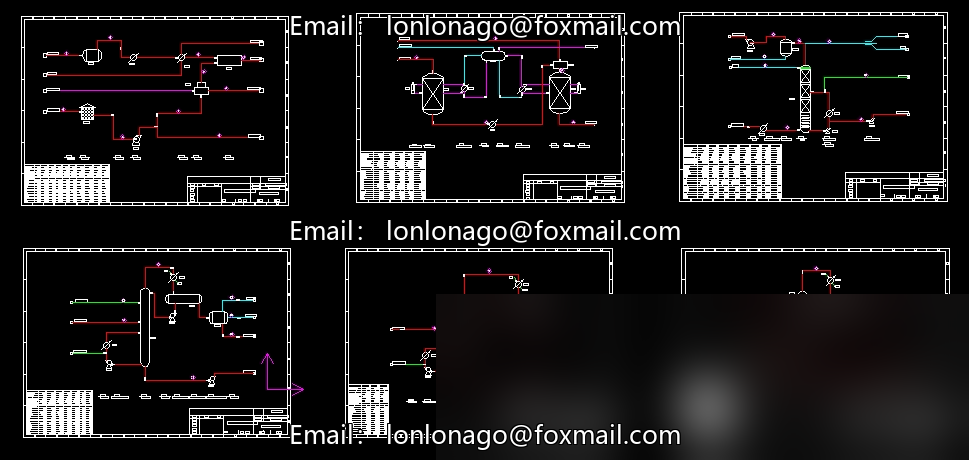
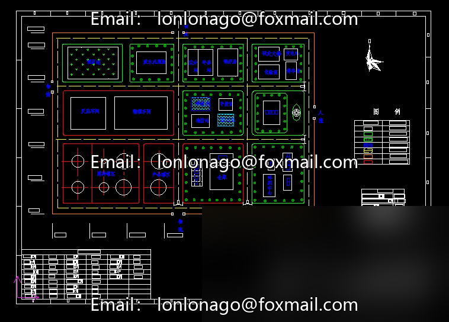
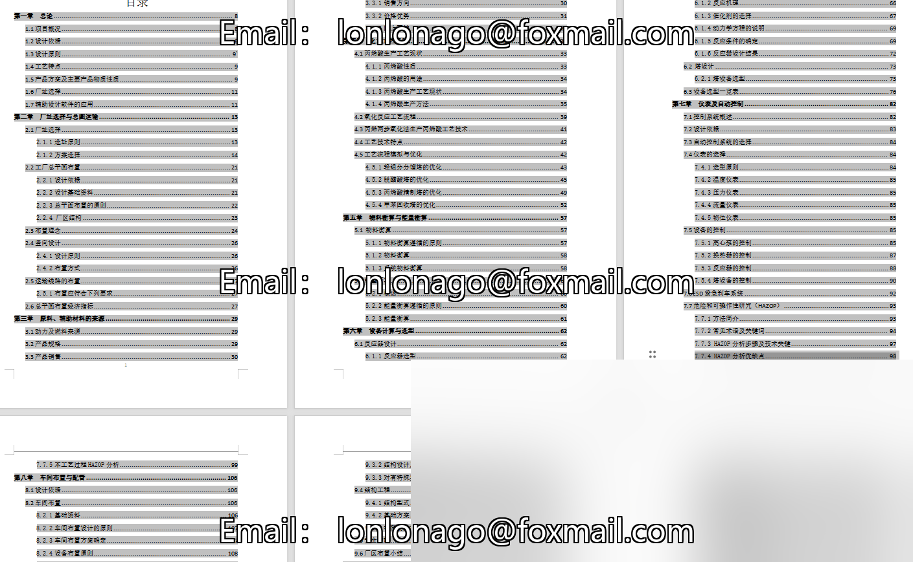
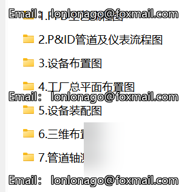
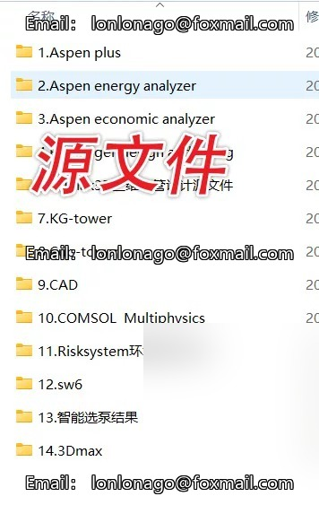

# Acrylic process design CAD materials

## Body

Acrylic process design CAD documents 487 Acrylic design Acrylic design Acrylic factory design Acrylic process design Acrylic chemical plant design Acrylic preparation design Acrylic preparation

The material covers acrylic acid process design CAD content along with related documents, including various design drawings and software tools.

<!-- AI_ENRICHED -->

## Images

## Payment

Here is a pay link on Stripe ( https://buy.stripe.com/3cs8yP7sY87d0vu9AB ). Please contact me lonlonago@foxmail.com after funding $89, and I will send you a complete data files , thank you!

